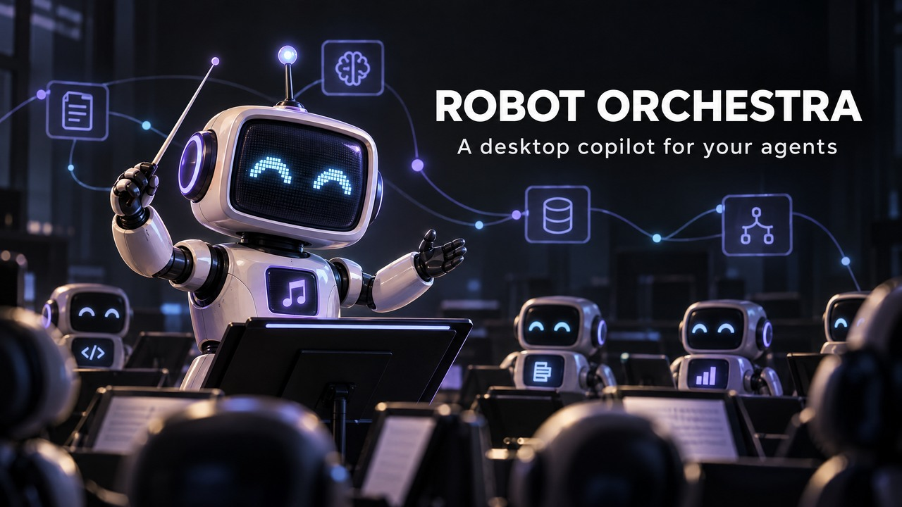
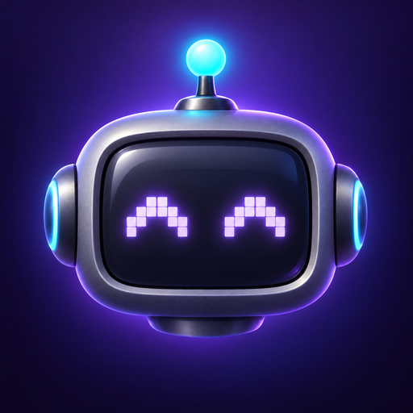
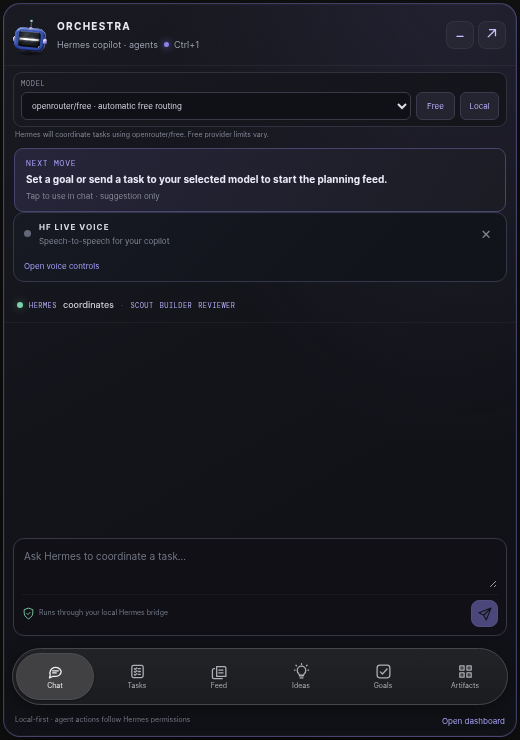
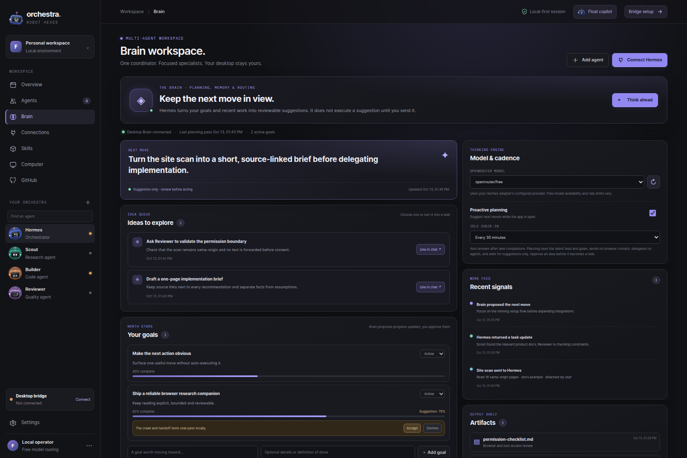
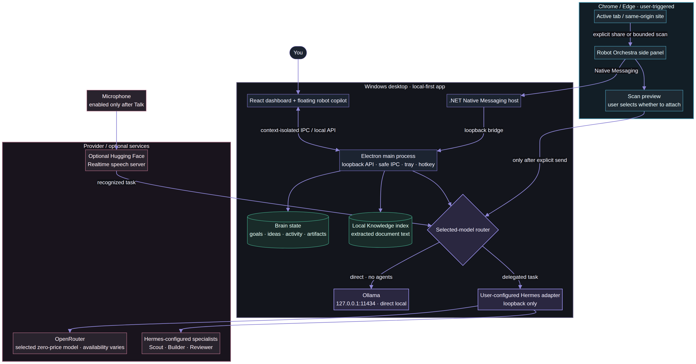

# Robot Heads · Robot Orchestra

<p align="center">
  
</p>

<p align="center">
  <a href="https://github.com/EdgeAgent/robot-orchestra/releases/latest"></a>
  
  <a href="https://github.com/EdgeAgent/robot-orchestra/releases/latest"></a>
  <a href="https://github.com/EdgeAgent/robot-orchestra/blob/main/LICENSE"></a>
  
  <a href="https://www.npmjs.com/package/robot-heads"></a>
  <a href="https://github.com/EdgeAgent/robot-orchestra/stargazers"></a>
</p>

<p align="center"></p>

<p align="center">
  <strong>A friendly multi-agent desktop copilot — plus animated robot avatars for React.</strong><br />
  Float the character, keep the next move in view, scan a site when you ask, and keep your agent bridge on your own machine.<br />
  <strong>Now with voice control + multi-screen sandbox:</strong> talk to the head, it delegates to agents by name, and you watch each agent work live on its own screen.
</p>

<p align="center">
  <br />
  <em>The floating chat head — tap Ctrl+1 to open this chat dock, drag the head anywhere on your desktop.</em>
</p>

<p align="center">
  <a href="apps/desktop/README.md"><strong>Windows install & setup</strong></a> ·
  <a href="https://github.com/EdgeAgent/robot-orchestra/releases/latest"><strong>Download Windows installer</strong></a> ·
  <a href="https://github.com/EdgeAgent/robot-orchestra/releases"><strong>All releases</strong></a> ·
  <a href="https://robot-heads.fayaz.workers.dev"><strong>Live playground</strong></a> ·
  <a href="#robot-orchestra">How it works</a> ·
  <a href="#robot-heads-react-library">React library</a>
</p>

> **Windows app:** Download the latest per-user Windows x64 installer from [GitHub Releases](https://github.com/EdgeAgent/robot-orchestra/releases/latest). Run the setup wizard, choose **Install**, and finish to launch; no administrator access is needed. The installer is unsigned, so Windows may show a SmartScreen warning. Chrome/Edge still require the separate one-time unpacked-extension step while store listings are pending. The app does not bundle Hermes or grant desktop-control permissions.

## Robot Orchestra

Robot Orchestra is a local-first Windows companion for connecting the character UI to **your** agent stack. Keep the full orchestra dashboard open, or drag the robot head anywhere on your desktop and tap **Ctrl+1** to open its compact copilot. The chat dock has six labeled sections: Chat, Tasks, Feed, Ideas, Goals and Artifacts. Tasks shows persisted task handoffs and returned updates; choosing **Continue** only drafts a follow-up and never reruns work automatically. A Brain workspace keeps a persistent next move, saved goals, model/cadence controls, activity signals and artifact references; planning is suggestions-only. Choose a local Ollama model for direct inference on this PC, or an OpenRouter zero-price model for tasks delegated through Hermes. In Chrome/Edge, explicitly scan a bounded number of same-origin pages, preview the extracted text, then choose whether to include it in a task. The optional Hugging Face live-voice panel streams audio only after you enable the mic, then sends the spoken task through the selected task model. The desktop bridge accepts only loopback service URLs.

The Brain also includes a **local Knowledge library** for PDF, DOCX, XLSX/XLSM, text, CSV and related business files. Imported text is stored in the Windows per-user app-data folder. Search stays local; relevant excerpts are sent only to the selected model when **Use local Knowledge** is checked. A previously shared browser page can be saved to the Brain only via the explicit **Save shared page to Brain** action—there is no passive browser-history monitoring.

<p align="center">
  
</p>

<p align="center">
  <em>Persistent Brain, with a six-section floating companion.</em><br />
  
</p>

## Voice control + multi-screen sandbox — new in this release

The floating head is the main agent. Voice is the control layer, screens are for watching.

- **Talk to it:** say any wake word you choose (default: "robot"), then talk normally. The head listens, thinks, and talks back — mouth moving, lights, smile — no lip-sync needed, and the mic never auto-starts.
- **Delegate by name or role:** "Outreach, draft outreach for London plumbers" goes to Agent 1. "Research, research competitors" goes to Agent 2. "Agent 1", "Agent 2", "Agent 3" still work as aliases. No name? The Boss picks by job.
- **Watch live:** each agent gets its own sandbox screen inside Orchestra's own desktop environment — its own browser, its own terminal, its own log, its own live view (noVNC, loopback only). Say "Show Outreach" to pop that screen up, "Show all agents" to see them all, "Stop Research" to stop just that one.
- **Approval gate, always:** send, ship, pay, or delete pauses and asks you by voice, with the exact job spoken back. Say "yes" to approve, "no" to cancel. No agent, no model, no learned rule can skip it.
- **Sandbox host:** on Windows, agents run inside WSL2 (Hyper-V fallback), not on your main desktop. Agent 1 → `http://127.0.0.1:6081/vnc.html`, Agent 2 → `6082`, and so on. If a stream fails, that agent pauses — it never runs blind.
- **Local voice server:** Moonshine (or Faster-Whisper) for speech-to-text, Piper for speech output, on `http://127.0.0.1:8765` only. No audio ever leaves your machine. Run `apps/desktop/scripts/setup-wsl2-sandbox.ps1` as Administrator to set up the WSL2 host, then start the voice server in WSL2.
- **Try it without a mic:** `node apps/desktop/demo-m1.cjs` runs the M1 rehearsal — one agent, one screen, plus the parallel killer demo (Outreach drafts + Research in parallel, batch approval) — with no sends, ever.
- **Free-model guard:** jobs stay narrow, retry once, then escalate to you. No endless loops, no faked success.

Full reference pack: [`docs/voice-multi-screen-reference.md`](docs/voice-multi-screen-reference.md). Audit (bugs found, live risks, what the live run needs): [`apps/desktop/AUDIT.md`](apps/desktop/AUDIT.md).

> **Honest status:** the voice logic, wiring, screens, sandbox host, and tests (19/19) are in this release. The live run on a Windows PC — real mic, real WSL2 sandbox stream, real SPACE — is the final proof step, and it needs the setup above. The original app on main still works exactly as before if you don't enable voice.

## Architecture map

The map shows the local Electron/React app, browser Native Messaging bridge, persistent Brain and Knowledge stores, direct Ollama route, Hermes/OpenRouter delegation, optional speech server, and the explicit browser-context handoff boundary.

<p align="center"><a href="docs/robot-orchestra-architecture.mmd"></a></p>

The editable Mermaid source is [`docs/robot-orchestra-architecture.mmd`](docs/robot-orchestra-architecture.mmd).

### Quick start on Windows

1. Download **Robot-Orchestra-Setup-0.6.0-x64.exe** from [Latest Releases](https://github.com/EdgeAgent/robot-orchestra/releases/latest), open it, follow the setup wizard, and click **Install**. On the finish page, leave **Launch Robot Orchestra** selected and click **Finish**. It installs for your Windows account without administrator rights. If a release asset is temporarily unavailable, use the [build-from-source instructions](apps/desktop/README.md#build-from-source-maintainers).
2. In Chrome or Edge, go to `chrome://extensions` or `edge://extensions`, enable **Developer mode**, and choose **Load unpacked**. Select the installed `resources/browser-extension` folder.
3. For specialist delegation, connect your Hermes adapter at a `localhost` URL and use **Test connection**. Direct Ollama chat works without Hermes.
4. Click the Robot Orchestra toolbar icon to open the browser side panel. Choose **Scan this site** if you want a bounded crawl (10/25/50 pages), review its text preview, and tick **Include this scan in my next message** only when you want to send that excerpt to the selected model. Or share one page / selected text directly.

### Local Ollama and free OpenRouter models

Install [Ollama for Windows](https://ollama.com/download/windows) on the same PC, start it, and download a model you choose with `ollama pull <model-name>`. In the Brain or floating chat, click **Local** / **Detect local Ollama** to find installed models, then select one. Robot Orchestra calls only `http://127.0.0.1:11434`; it does not upload prompts to a model host or require an Ollama API key. Ollama tasks and planning run directly and do **not** use Hermes, Scout, Builder or Reviewer. Model licenses, resource needs and speed depend on the model and hardware.

For delegated tasks, click **Free** / **Load OpenRouter free** and choose `openrouter/free` or a model listed at zero token price. That choice uses your loopback Hermes adapter and its configured provider; free model availability, provider limits and model access can change. Llama appears in its own OpenRouter group only when the live catalog lists a Llama model with both prompt and completion prices at zero. On 2026-10-19, the current catalog listed no zero-price Llama variant; an installed local Llama can instead be selected from the Ollama group after detection. The selected task model is shared between the dashboard and floating chat. Browser-page and Knowledge excerpts remain opt-in in either route.

### Optional Hugging Face live voice

The companion's **HF Live Voice** panel connects to the open-source [Hugging Face speech-to-speech realtime server](https://github.com/huggingface/speech-to-speech). Follow the [Windows setup](apps/desktop/README.md#optional-hugging-face-live-voice), leave its local `speech-to-speech serve` process running, connect to the default loopback endpoint, and click **Talk** each time you want the microphone on. The speech server handles audio; the recognized task then follows your selected Ollama or Hermes/OpenRouter route. Browser and Knowledge context still follow their existing unchecked-by-default controls. No Hugging Face inference token is needed for the upstream local model server. Model downloads and inference happen on your PC by default, but the upstream Windows pipeline can need substantial GPU memory; CPU fallback may be slow.

The microphone is never started on launch or connection. Raw audio is sent directly to the configured voice endpoint and isn't saved by Robot Orchestra. The default endpoint is local; only use a remote `wss://` endpoint you trust. The model server is optional and is not bundled with the Windows installer.

**That's the setup boundary:** desktop app install is a normal Windows installer; browsers require the separate developer-mode step because the extension is not yet published to the Chrome Web Store or Edge Add-ons. See the [step-by-step installation and troubleshooting guide](apps/desktop/README.md).

### What it does—and doesn't

- **Coordinator + specialists:** example Hermes, Scout, Builder and Reviewer roles; connect your own compatible local Hermes adapter.
- **Floating desktop copilot:** drag the always-on-top character, pop open the compact chat with **Ctrl+1**, and switch between Chat, Tasks, Feed, Ideas, Goals and Artifacts without reopening the dashboard.
- **Brain planner:** save goals, review the next move, track task/scan outcomes and artifact references, choose a local Ollama model or a zero-price OpenRouter model, and opt into 15/30/60-minute planning check-ins. Planning is suggestions-only and carries no browser context or specialist delegates; local planning calls Ollama directly, while OpenRouter planning goes through Hermes with no-tools/no-delegates flags.
- **Local Knowledge library:** import supported business files, search extracted text locally, and explicitly attach relevant snippets to a copilot task. Saving a shared page is user-click only; Robot Orchestra does not watch browsing history.
- **Explicit website scans:** Chrome/Edge asks for per-origin permission only after you click scan; reads at most 50 HTML pages, stays on the original site, does GET only, checks `robots.txt`, and limits each page to 800 KB and extracted text to 12,000 characters sent with an explicitly selected scan. Same-origin reads may use your signed-in browser session. Nothing is sent to a model until you check the handoff option and press **Send task**; the Brain model setting selects direct Ollama or Hermes.
- **Agent handoff:** OpenRouter task models go to your local Hermes coordinator with Scout, Builder and Reviewer offered as specialist delegates; real delegation depends on your Hermes adapter. Ollama mode is direct inference and does not delegate.
- **Live voice (optional):** Hugging Face's OpenAI-Realtime-compatible speech server handles speech recognition and speech output; the recognized task uses the selected Ollama or Hermes/OpenRouter route. Microphone permission is restricted to audio from the app's own loopback renderer. The speech server is installed and run separately.
- **Voice control + multi-screen sandbox (new):** talk to the head, delegate by role ("Outreach", "Research", "Builder") or Agent number, watch each agent live on its own WSL2 sandbox screen, and approve sends/ships/pays/deletes by voice. See the section above.
- **Browser side panel:** explicitly share one page or choose a same-origin 10/25/50-page scan. Per-origin host permission is requested on click; `robots.txt`, `noindex`/`nofollow`, a no-redirect origin lock, byte/depth/time caps, and a separate preview/attach step bound the crawl. Page GETs may use the browser's existing session; nothing is sent to a model until you opt into the scan and submit a task.
- **OpenRouter:** discover zero-price models for Hermes delegation. Free model availability and provider limits may change. Ollama is a separate direct-local route.
- **Optional Jev routing:** ask Jev to choose one agent/model from supplied allowlists. Jev uses its own API key.
- **Your permissions remain yours:** the Brain sends planning-only/no-tools/no-delegates flags to your configured adapter and never auto-submits recommendations, but cannot enforce policies inside that adapter. Verify your Hermes adapter honors those flags. Robot Orchestra does not grant desktop-control tools or approve actions.

## Robot Heads React library

Animated, glossy TV-headed robot avatars with LED-matrix faces, four shapes, springy antennas, and expressive states. Drawn on a 2D canvas: **no WebGL and no runtime dependencies**.

```bash
npm install robot-heads
```

React 18 or newer is a peer dependency. See the [component quick start](#quick-start), [all shapes and states](#shapes), and the [live playground](https://robot-heads.fayaz.workers.dev).

## Install

```bash
npm install robot-heads
```

React 18 or newer is a peer dependency.

## Quick start

```tsx
import { RobotHead } from "robot-heads";

function Agent({ status }: { status: "idle" | "thinking" | "speaking" }) {
  return <RobotHead state={status} size={160} />;
}
```

## Shapes

One head, four outlines. Every shape carries the same screen, ears, antenna, screws and back panel, and moves the same way.

```tsx
<RobotHead shape="rectangle" />  {/* the classic TV (default) */}
<RobotHead shape="square" />
<RobotHead shape="circle" />     {/* a porthole */}
<RobotHead shape="hexagon" />    {/* a nut, flat on top */}
```

The list is exported as `robotHeadShapes`.

## States

Each state has its own face on the screen, its own motion and its own antenna light. Switching states plays a short glitch and cross-fade, and the head eases into its new pose.

| State       | Screen                                           | Motion                                              |
| ----------- | ------------------------------------------------ | --------------------------------------------------- |
| `idle`      | block eyes that blink and glance                 | looks around, hops now and then                     |
| `thinking`  | heavy-lidded eyes looking up, three pulsing dots | head tilted up, switching sides; amber light pulses |
| `searching` | darting eyes, a beam sweeping the whole screen   | head sweeps side to side; cyan beacon               |
| `listening` | alert eyes over a live equaliser                 | head cocked, small nods; steady green light         |
| `speaking`  | a mouth that moves with the words                | bobs as it talks                                    |
| `working`   | focused eyes looking down, a progress bar        | busy bobbing, a hop with a spin now and then        |
| `happy`     | `^ ^` eyes and a smile                           | bouncy hops                                         |
| `error`     | red `X X` eyes                                   | shakes its head; red light blinks                   |
| `sleeping`  | closed eyes and rising z's                       | head drooped, slow breathing; light off             |

The list is exported as `robotHeadStates`.

## Props

```tsx
<RobotHead
  shape="rectangle" // rectangle, square, circle or hexagon
  state="idle" // what it is doing (above)
  size={160} // px, the box the robot rests in (below)
  color="#2b49a3" // the shell
  trimColor="#93a6c8" // the ears and the antenna's collar
  screenColor="#e8f2ff" // the LEDs
  speed={1} // multiplier on every animation
  paused={false} // hold the state's still pose
  interactive // follow the pointer, hop and spin on a click
  antenna // the antenna's stem and light; off, the knob stays
  floorShadow // the soft shadow under the head
  seed={0.3} // 0–1, desyncs blinks and glances in a row of heads
/>
```

Any other attribute (`className`, `style`, `onClick`, `aria-label`, …) goes on the element, and a `ref` reaches the `<canvas>` inside it.

## Sizing and layout

`size` is the robot itself: the element is a `size` × `size` box with the robot at rest centred in it, filling it, antenna included. It lines up with text, sits in a flex row, and centres like an icon or an avatar would.

Its motion is not part of that box. Hops, the antenna's glow and the floor's shadow draw past its edges — like a CSS `box-shadow`, they overflow without taking any room in your layout, and only the box takes clicks. So margins, flex and grid treat it as exactly `size` × `size`; the one thing to watch is a parent with `overflow: hidden` right round it, which would cut off a hop.

## Behaviour

- **Pointer play.** With `interactive` on (the default), the head and eyes follow a nearby pointer, and a click makes it hop with a full spin and a happy face.
- **Small sizes.** For avatars in a list, `antenna={false}` drops the antenna's stem and its light, keeping the knob on top, so the head itself fills more of the box (the square, circle and hexagon grow; the wide rectangle is already as big as its width allows).
- **Reduced motion.** With `prefers-reduced-motion: reduce`, or `paused`, the still pose of the state is drawn instead of the animation.
- **Accessible by default.** The canvas has `role="img"` and an `aria-label` naming the state ("Robot, thinking"); pass your own `aria-label` to override it.
- **Cheap to run many.** Every head on the page shares one animation loop, which sleeps while the tab is hidden, and heads of the same shape and size share their baked textures.

## How it is drawn

The head is real geometry: a shell with a rolled edge — its outline a convex polygon of corner centres grown by a corner radius, so one builder makes every shape — lathed knob ears and an antenna collar, built once as quad meshes. Each frame it is turned with the pose and projected, back faces are culled, and every quad is lit by a small studio model: a key light, a fill, a sky dome, a softbox and the key's window caught as clear-coat reflections with Fresnel, a cool back light rimming the silhouette, and a filmic tone curve.

The flat front and back are plates drawn in their own plane with baked relief: the lip rolling into the screen hole, the rubber gasket, the shadow the lip casts onto the glass, screws, and vents on the back. The glass sits a little behind the bezel, so it slides against it as the head turns. The LED matrix covers the whole screen, the face centred on it; the LEDs are drawn crisp, then bloomed from a one-pixel-per-LED image scaled up smooth. The antenna is a damped spring that whips when the head hops, lands or tilts, topped with a frosted bulb lit from inside.

## Development

The repo is a pnpm workspace: the library at the root, the playground in `site/` — a React app on [Vite](https://vite.dev) served by a [Cloudflare Worker](https://developers.cloudflare.com/workers/). The playground runs on the library's source, so edits hot-reload there.

```bash
pnpm install
pnpm run dev       # the playground
pnpm run build     # the library, to dist/
pnpm run typecheck
pnpm run deploy    # build and deploy the playground Worker
```

```
src/            the library
  RobotHead.tsx   the component
  tv/             the TV head: geometry, lighting, faces, motion, renderer
site/           the playground (Vite + Cloudflare Worker)
```

## License

[MIT](LICENSE) © [Fayaz Ahmed](https://x.com/fayazara)

The playground is set in [Open Runde](https://github.com/lauridskern/open-runde) by Laurids Kern, under the SIL Open Font License 1.1 (`site/public/fonts/OFL.txt`). The font is not part of the npm package.
