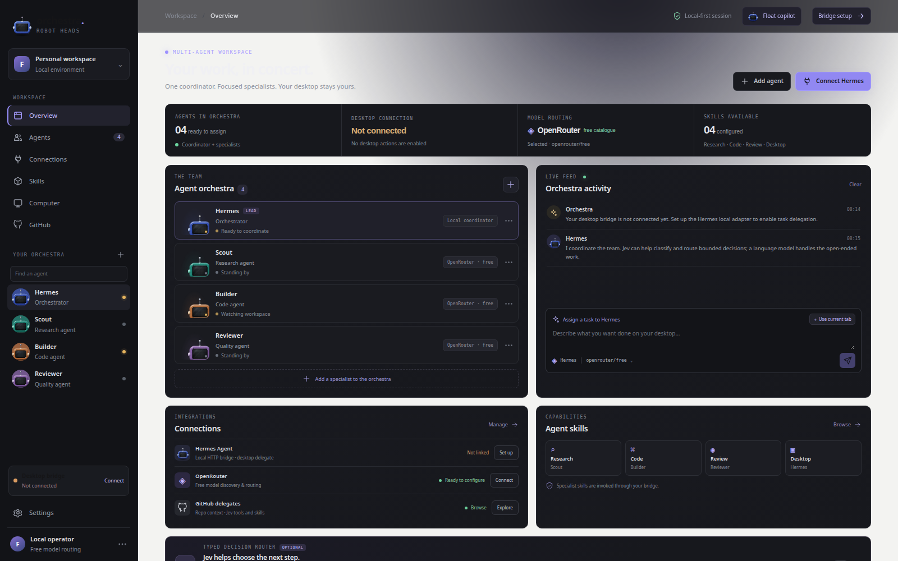

# Robot Orchestra for Windows

A native Windows copilot that lives as an always-on-top, draggable robot head when you want it, expands into a chat bubble on demand, and can use either local Ollama or Hermes delegation. The desktop app is a **per-user Windows x64 installer**; the Chrome/Edge side panel is a separate, one-time setup step while the store listing is pending.

[Project Releases](https://github.com/EdgeAgent/robot-orchestra/releases/latest) · [Back to project overview](../../README.md)



## Install in a few minutes

### 1. Install Robot Orchestra

1. Download the latest `Robot-Orchestra-Setup-*-x64.exe` from [GitHub Releases](https://github.com/EdgeAgent/robot-orchestra/releases/latest).
2. Double-click the `.exe`. Windows may ask you to confirm opening an unsigned installer; verify it came from this project's Releases page.
3. Follow the familiar setup wizard: choose an install folder if you want to change the default, then click **Install** and wait for setup to finish. No administrator access is needed; it installs for your Windows account.
4. Leave **Launch Robot Orchestra** selected on the finish page and click **Finish**. Setup creates Start Menu and desktop shortcuts.
5. Leave the app running while using the browser extension. To uninstall, use Windows **Settings → Apps → Installed apps**.

> Windows may show a SmartScreen warning while the installer is unsigned. Only download the installer from the project's GitHub Releases. This project does not currently ship a code-signing certificate.

> **Robot Orchestra 0.6.0:** The Windows installer is attached to the [latest public release](https://github.com/EdgeAgent/robot-orchestra/releases/latest). If the release asset is unavailable, follow [Build from source](#build-from-source-maintainers).

### 2. Add the Chrome or Edge side panel

Chrome and Edge do not allow this project to silently install an unpublished extension. Load it once yourself:

1. Open `chrome://extensions` (Chrome) or `edge://extensions` (Edge).
2. Turn **Developer mode** on.
3. Select **Load unpacked**.
4. Choose the installed folder `resources/browser-extension` inside the Robot Orchestra install directory. If you changed the install location, use that location's `resources/browser-extension` folder.
5. Pin the Robot Orchestra extension if desired. Click its toolbar icon to open the side panel.

The desktop installer registers the local Native Messaging bridge for your Windows account in both Chrome and Edge. You do not need to run a separate registry script.

### 3. Connect your Hermes adapter

1. Open Robot Orchestra and choose **Connect Hermes** or **Bridge setup**.
2. Enter the loopback address of your Hermes adapter (for example, `http://127.0.0.1:4178`).
3. Your adapter must provide `GET /health` and accept tasks at `POST /v1/orchestra/tasks`.
4. Select **Test connection**. Once healthy, the URL is saved locally so the browser side panel can reach Hermes.

The app intentionally rejects remote Hermes URLs. Choose a model in Brain or the floating chat. `openrouter/free` and discovered zero-price OpenRouter IDs route through the configured Hermes adapter, which must support that model. `ollama:<name>` is a separate direct-local route to Ollama at `http://127.0.0.1:11434`; it does not require Hermes or delegate to sub-agents.

## Local Ollama and free OpenRouter models

To use local text inference, install [Ollama for Windows](https://ollama.com/download/windows), start it, then download a model you choose in PowerShell:

```powershell
ollama pull <model-name>
```

In the Brain model selector or floating chat, click the **Local** / **Detect local Ollama** button and choose one of the detected `ollama:<name>` entries. Detection and chat call only Ollama's loopback API at `127.0.0.1:11434`; Robot Orchestra does not install models, send a prompt to a model host, or require an Ollama token. Direct Ollama chat, browser tasks and suggestions-only Brain planning bypass Hermes, Scout, Builder and Reviewer. Model license, memory needs and speed depend on the model and your PC. Browser and Knowledge context remain opt-in; when enabled, selected excerpts are sent to the local Ollama endpoint.

For agent delegation, select `openrouter/free` or click **Free** / **Load OpenRouter free** and choose a zero-price model. That route sends the task to your loopback Hermes adapter, which must be configured for the selected model/provider and handles actual delegation. Zero token price does not guarantee constant access, no rate limits or no provider changes. Llama appears in its own choice group only if OpenRouter's live catalog reports both prompt and completion prices as zero. On 2026-10-19, the live catalog offered no zero-price Llama model; an installed local Llama appears in the Ollama group after detection. The selected model is shared between the dashboard, Brain, floating chat and browser-side task routing.

## Optional Hugging Face live voice

The chat bubble can connect to Hugging Face's open-source **speech-to-speech** realtime server. Robot Orchestra's default endpoint is `ws://127.0.0.1:8765/v1/realtime`; the speech and language models run on your PC by default, so this local setup does not need a Hugging Face inference token or hosted inference credits. The first model run downloads the upstream models and may take several minutes. Hugging Face's current Windows hardware guidance plans for about 24 GB of NVIDIA VRAM; its CPU fallback is supported but can be slow.

In PowerShell, install the optional backend in its own Python environment and start its loopback server:

```powershell
mkdir "$env:USERPROFILE\RobotOrchestraVoice"
cd "$env:USERPROFILE\RobotOrchestraVoice"
py -3.11 -m venv .venv
.\.venv\Scripts\python.exe -m pip install --upgrade pip
.\.venv\Scripts\python.exe -m pip install speech-to-speech
.\.venv\Scripts\speech-to-speech.exe serve
```

Leave that terminal running. In the floating chat, open **HF Live Voice**, connect to the default address, then click **Talk** and speak. Pause to finish a turn; the microphone automatically turns off after the turn and the spoken task follows the selected text-model route (direct Ollama or Hermes/OpenRouter). The HF speech server still handles speech recognition and audio output; it is separate from the selected text model. **Use shared browser context and local Knowledge only when their existing checkboxes are selected.** Re-enable the mic for each turn; the app never starts recording on launch or connection.

Robot Orchestra does not store raw microphone audio. Audio is streamed directly to the URL shown in the voice panel; the default is loopback on this PC. The recognized task and selected text-model response follow the normal chat path. A remote endpoint must use `wss://` and must be a service you trust; this client does not send custom authorization headers or store voice API keys. The speech server is optional, separate from the installer, and may need a capable GPU or a slower CPU fallback. See the upstream [speech-to-speech quickstart](https://github.com/huggingface/speech-to-speech#quickstart) for current model and platform requirements.

## Floating copilot and Ctrl+1

- From the dashboard, choose **Float copilot**. The dashboard hides and a small robot head remains above your other windows.
- Click the head or press **Ctrl+1** to open the compact chat bubble. Press **Ctrl+1** again, or choose **−**, to collapse the chat back to the head. The registered hotkey works globally while Robot Orchestra is running.
- Use **↗ Open full dashboard** in the bubble to return to the orchestra control room. Closing the dashboard window also tucks the app into the floating head instead of quitting.
- The system-tray menu can reopen the dashboard/head or **Quit Robot Orchestra**. Use **Quit** to fully stop the global hotkey and background app.
- With an OpenRouter model selected, chat tasks go to Hermes with Scout, Builder, and Reviewer offered as specialist delegates. Hermes and your adapter decide and perform the real sub-agent work; the floating UI shows delegate statuses returned by the adapter. With an Ollama model selected, chat is direct-local and no specialists are invoked. The most recent 80 chat entries are held in memory until the app exits.
- If a browser tab was explicitly shared from the extension, the chat shows an **Include shared tab** checkbox. It is off by default; only checking it attaches that already-shared page context to the next task.
- The bottom navigation switches between six labeled sections: **Chat, Tasks, Feed, Ideas, Goals, and Artifacts**. Tasks shows persisted handoffs and returned updates. **Continue** drafts a follow-up in chat but does not send or rerun it.

## Brain: next moves, feed, goals and artifacts

Open **Brain** in the dashboard to add goals, choose a local Ollama or OpenRouter model, inspect the latest next move, approve/dismiss goal-progress proposals, and control the 15/30/60-minute idle-planning cadence. Task completions, site-scan handoffs, planning summaries, and file/URL references returned by Hermes can populate the same local feed and artifact shelf in both the dashboard and floating head. Brain state is stored in your Windows per-user app-data folder; the most recent 80 chat messages remain in memory only.

The Brain uses the selected model for a suggestions-only planning response. In Ollama mode, the request goes directly to local Ollama and no tools or delegates are provided. With an OpenRouter model, the Brain asks the configured loopback Hermes endpoint with `planningOnly: true`, `allowTools: false`, and an empty delegate list. Both modes send recent feed summaries and active goals, **not browser page text**. Automatic planning is enabled by default and runs only while Robot Orchestra is open and there is work to review; disable **Proactive planning** if your Hermes adapter does not honor its no-tools/planning-only contract. Recommendations are not submitted as tasks until you choose them and send a chat message. The app cannot enforce the Hermes adapter's policies itself.

### Local Knowledge: import, search and share only when asked

In **Brain → Business source library**, choose **Add files** and select up to 20 files per batch (20 MB each; 64 MB per batch). Supported formats include PDF (text-based PDFs), DOCX, XLSX/XLSM, TXT/Markdown, CSV/TSV, JSON, HTML/XML and logs. Legacy `.xls` and image-only PDF OCR are not supported. Text is extracted locally and stored in the app's per-user data folder; originals are not uploaded. Use the local search box to preview matching excerpts. In copilot chat, **Use local Knowledge** is off by default; check it to attach relevant excerpts (up to 18,000 characters) to the selected model. A page already shared from the browser can be persisted only by clicking **Save shared page to Brain**. No browsing-history or background site indexing occurs.

## Scan and read website pages

1. Open the site you want to read and choose the Robot Orchestra toolbar icon.
2. Choose a 10, 25, or 50 page cap and click **Scan this site**. Chrome/Edge will request permission for that exact origin. It remains granted until revoked in the browser's extension site-access settings; Robot Orchestra only fetches pages when you click **Scan this site**.
3. The scanner checks `robots.txt` without cookies, stays on the original origin and refuses page redirects, uses GET-only HTML reads (which may use your current signed-in session), skips common action/download URLs, observes page `noindex` and `nofollow`, and caps each response at 800 KB. A 10-second page timeout and **Stop** button limit a run.
4. Review the page titles and text snippets in the panel. The crawl result stays in that panel's memory unless you check **Include this scan in my next message** and press **Send task**. The outgoing excerpt is capped at 12,000 characters. Clear the results to discard them; revoke an origin's permission in Chrome/Edge extension settings.

For single-page questions, select text yourself and press **Send task**, or use **Share current page**. Browser-internal pages such as `chrome://` cannot be shared or scanned. No tab is read in the background.

## Jev routing (optional)

Robot Orchestra can optionally ask Jev to pick one specialist and one OpenRouter model from the exact candidates provided to it. Jev is a typed-choice router, not the task-performing agent and not an authorization system.

- Jev needs a separate API key from [Jev AI key settings](https://thejevai.com/settings/apikeys); it is not an OpenRouter key.
- Entering the key in the UI keeps it in tab memory only.
- Jev receives the task and candidate names; the current page's browser context is kept out of that Jev request.
- The app verifies that Jev's selections match the submitted allowlists before returning them.
- Hermes and your configured language model perform the open-ended work.

## Privacy and permissions

- The desktop local service binds only to `127.0.0.1`; do not expose it to the internet.
- The extension requests `activeTab`, `scripting`, `nativeMessaging`, and `sidePanel`; optional HTTP/HTTPS host access is requested for the exact site only when you click **Scan this site**.
- A scan uses the site's existing session for same-origin page GETs, but sends no page text to a model until you tick **Include this scan in my next message** and submit with **Send task**. Page URLs/text from one-tab share are sent only when you explicitly choose **Share current page** or submit a task.
- Brain planning may send recent feed summaries, saved goals and artifact references to your local Hermes adapter, but deliberately excludes browser context. It requests suggestions with no tools or delegates; the adapter must honor those fields.
- Imported Knowledge text stays in the local per-user app-data folder. A selected task receives matching excerpts only when you check **Use local Knowledge**; they go to the selected model (local Ollama or your loopback Hermes route). A browser page is stored only after the explicit save action. Remove imported sources from the Brain library at any time.
- Ollama model discovery and direct chat use only `127.0.0.1:11434`; Robot Orchestra does not install a model or configure cloud access for Ollama. Choose Ollama only when its local server is running. The OpenRouter catalogue is a separate provider route through Hermes; zero-price models can have quotas or availability changes.
- The tested Hermes URL is stored in the app's local per-user settings. The optional Jev key is not written to persistent app settings.
- The app does not bundle Hermes, install computer-use/MCP skills, or decide which actions an agent may take. Configure action approvals and permissions in your own Hermes setup.
- Live voice is optional and microphone access is requested only when you click **Talk**. Electron grants audio-only access to the app's own loopback renderer; camera access and remote-origin media are denied. Audio streams directly to the chosen realtime endpoint (loopback by default) and is not saved by Robot Orchestra. The speech server is separate and its models may require substantial local compute.

## Troubleshooting

| Symptom                                         | Try this                                                                                                                                                                                  |
| ----------------------------------------------- | ----------------------------------------------------------------------------------------------------------------------------------------------------------------------------------------- |
| Side panel says the desktop app is disconnected | Open Robot Orchestra and keep it running (a floating head or dashboard is fine). Check that the Windows installer completed and the native host registration exists for the current user. |
| Ctrl+1 does not open the chat                   | Confirm Robot Orchestra is still running (check its tray icon). Choose **Chat with Hermes · Ctrl+1** from the tray menu; another application may have reserved the global shortcut.       |
| I want to quit, not just hide the dashboard     | Open the Robot Orchestra system-tray menu and choose **Quit Robot Orchestra**. Closing the dashboard intentionally leaves the floating head available.                                    |
| Browser cannot load the extension               | Confirm Developer mode is enabled and that you selected the installed `resources/browser-extension` folder itself.                                                                        |
| Page share fails                                | Use a regular `https://` or `http://` page, click the extension toolbar action on that page, then try again. Browser-internal and restricted pages cannot be read.                        |
| Hermes test fails                               | Start your local adapter, verify `GET /health`, use a loopback URL such as `http://127.0.0.1:<port>`, and check the adapter logs.                                                         |
| Local Ollama model is missing                   | Start Ollama, run `ollama pull <model-name>` in PowerShell, then click **Local** / **Detect local Ollama** again. The app checks only `127.0.0.1:11434`.                                   |
| Tasks relay but do not execute                  | Check your Hermes task endpoint and local provider/model configuration. Robot Orchestra only passes the task to Hermes; it is not a substitute for the Hermes runtime.                    |
| Reinstalling or removing the app                | The installer removes its Chrome/Edge Native Messaging registry entries on uninstall. Remove the unpacked extension from the browser's Extensions page separately.                        |

## Build from source (maintainers)

Prerequisites: Node.js 22, pnpm 10+, .NET 8 SDK, and Windows x64 for the simplest native build.

```powershell
pnpm install
pnpm --filter robot-heads-site run build
dotnet publish apps/desktop/native-host/RobotOrchestra.NativeHost.csproj `
  --configuration Release --runtime win-x64 --self-contained true `
  --output apps/desktop/native-host-publish
npm install --prefix apps/desktop
npm run dist:win --prefix apps/desktop
```

The installer is written to `apps/desktop/release/Robot-Orchestra-Setup-<version>-x64.exe`. It uses an interactive per-user NSIS wizard, lets the user choose an install directory, offers an Install step and finish page, can launch the app after setup, creates Start Menu and desktop shortcuts, includes the app icon, and registers Chrome/Edge Native Messaging under `HKCU`.

Run the local API and browser crawler suites with:

```powershell
node apps/desktop/test/local-api.test.cjs
node --test apps/desktop/test/voice-protocol.test.mjs
node --test apps/desktop/test/ollama-client.test.cjs
node --test apps/browser-extension/test/crawler.test.mjs
```

The desktop build uses electron-builder's per-user NSIS target. Signing and browser-store publishing are not included. Live voice is an optional client integration; the Hugging Face speech-to-speech model server is not bundled in the installer.

## Technical overview

- `main.cjs` — Electron shell, tray, global Ctrl+1 hotkey, always-on-top companion window, and loopback-only local HTTP bridge.
- `preload.cjs` — narrow, context-isolated IPC bridge for companion/window controls.
- `native-host/` — .NET 8 Chrome/Edge Native Messaging host.
- `../browser-extension/` — Manifest V3 toolbar action and persistent side panel.
- `test/local-api.test.cjs` — local API regression tests for CORS, loopback validation, audio-only microphone permission, Brain persistence/planning boundaries, direct Ollama, Hermes relay, Jev allowlists, and opt-in browser context.
- `ollama-client.cjs` — bounded non-streaming local chat client pinned to Ollama at `127.0.0.1:11434`; validates installed model IDs before each task.
- `../site/src/CompanionVoice.tsx` — opt-in PCM16 Realtime client; recognized tasks follow the selected Ollama or Hermes/OpenRouter route.
- `test/voice-protocol.test.mjs` — endpoint validation, Hermes tool allowlist, request shape and PCM16 conversion tests without a microphone or external server.
- `../browser-extension/crawler.mjs` — permission-on-click, same-origin, robots-aware, bounded HTML crawler; its Node tests run without external services.
- `../..` — shared React orchestration dashboard and original Robot Heads component library.
